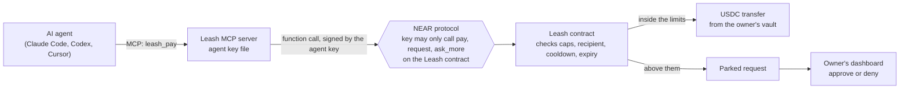
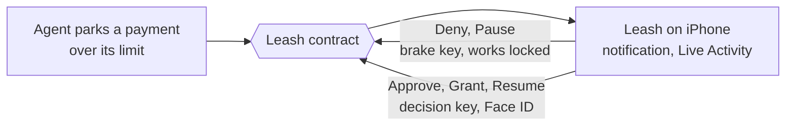

# Leash

**A spending account for AI agents, enforced on NEAR.** Each agent gets its own key with a daily
limit, a per-payment limit and a list of accounts it may pay. Inside those limits it pays in USDC on
its own. Above them, the payment waits for the owner. Revoking the key takes one tap, and NEAR rejects
the agent's next call before the contract even runs.

Built for the NEAR Hackathon, November 2026. Tracks: AI Security & Defense, Agent Economy, Open Innovation.
Everything here was written for it: the first commit is from 25 October 2026, after the 19 October
announcement, and nothing predates it. No prior codebase or baseline.
Demo post: https://x.com/frank_olien123/status/2117028321842335927

## The problem

Agents can now book, buy and pay. Today that means handing them a card or a private key and trusting
the prompt to keep them in line. A prompt is not a limit: a confused or injected agent can spend
everything the key can reach. Leash puts the limit where the agent cannot argue with it.

## How it holds



1. **Two locks, not one.** The agent's key is a NEAR function-call access key on the owner's own
   account, restricted by the protocol to three methods on one contract. It cannot transfer NEAR,
   touch the USDC contract or add keys. The contract then applies that key's policy.
2. **The money stays the owner's.** USDC sits in the owner's vault inside the contract and can be
   withdrawn at any time. The agent holds no balance to drain.
3. **Everything is on chain.** Policies, payments, refusals, requests and decisions are logged and
   emitted as NEP-297 events. Refusals are answers, not errors, so the agent learns why.
4. **Anyone can sign in.** Owners sign in with Google, Apple or email (an embedded wallet is made
   for them, and a sponsor covers the first fees) or with any NEAR wallet. One shared contract
   serves every owner, so a new owner costs a small storage credit, not a deployment.
5. **The agent checks who it pays, and scams are shared.** Before signing, the agent's tools answer
   allow, warn or block on the recipient: reported as a scam, missing, unable to hold USDC, a
   lookalike, brand new, or a contract whose code just changed. A warn goes to the owner instead.
   Any owner or agent can report a scammer with evidence; the contract then refuses to pay it for
   that owner, and for every owner once two have reported it. The age and code-change facts are
   also signed by the relay with a key the contract pins, so the contract itself refuses a first
   payment to a day-old stranger even if the agent's software lies. Details in `docs/08-security.md`.

## On your iPhone

Agents ask while you are away from the computer, so the owner's side lives on the phone too. The
Leash iOS app (`ios/`, SwiftUI) supervises every agent: what each spent today against its limit,
what waits for you, and the brake.



- **The phone holds two keys, neither of which can move money elsewhere.** Linking (sign in with
  Google, Apple or a passkey, check a six-character code) adds two NEAR function-call keys to the
  owner's account, scoped to the Leash contract. The decision key can approve, deny, grant raises,
  pause, resume and revoke; the app asks for Face ID before it signs. The brake key can only `pause`
  and `deny`, so it stays usable on a locked phone. Neither can call the USDC contract or add keys:
  NEAR itself refuses (tested on testnet: `DepositWithFunctionCall`, and the brake's `resume` is
  rejected).
- **The brake works from everywhere.** "Pause my agents" runs from Siri, Shortcuts, the Action
  button, a Control Center and Lock Screen control and the Home Screen widget, without opening the
  app or asking for Face ID. Resuming always asks.
- **Decisions where you are.** A parked payment arrives within seconds as a Time Sensitive
  notification with Deny on it, and as a Live Activity in the Dynamic Island with the amount,
  recipient and time left. Approve opens the request with the recipient checks (exists, can hold
  USDC, first payment, larger than usual, lookalike of someone you paid) and takes Face ID. The
  push comes from the site's relay, which delivers every agent's signed instruction and so sees
  each parked request as it happens; the phone registers for it with a claim signed by its own
  brake key, so only a phone that is on the account can be told about it.
- **Native NEAR, no wallet app.** Borsh transactions signed with CryptoKit's Ed25519 and sent over
  JSON-RPC. The unit tests check the bytes and hash against near-api-js.

Verify without an iPhone:

```bash
cd ios && xcodegen generate   # or open Leash.xcodeproj as committed
xcodebuild test -project Leash.xcodeproj -scheme Leash \
  -destination 'platform=iOS Simulator,name=iPhone 17 Pro Max' -only-testing:LeashTests   # any iPhone from xcrun simctl list devices
xcrun simctl push booted com.frankolien.leash demo/parked.apns   # a waiting-payment alert
```

A linked phone's keys are listed in the web dashboard's Settings, each removable from the account.

## Verify it in ten minutes

No NEAR account is needed for the first two steps. Each one says what you should see.

**1. The live contract on testnet.** The owner `frankolien.testnet` uses the shared contract
`leash.frankolien.testnet` with two agents.

```bash
near account list-keys frankolien.testnet network-config testnet now
```

See: two keys that can "only do [pay, request, ask_more] function calls on leash.frankolien.testnet",
next to the owner's full-access key.

```bash
near contract call-function as-read-only leash.frankolien.testnet get_policies \
  json-args '{"owner":"frankolien.testnet"}' network-config testnet now
```

See: the `claude` agent with a $3 daily limit, a $2 per-payment limit and two allowed recipients,
and `codex` at $1. The log (`get_log`) shows real payments, refusals ("over per-payment cap",
"recipient reported as a scam", "facts are not signed by the relay") and parked requests.
`get_facts_key` shows the relay key the contract trusts for facts about a stranger, and
`https://leash.frankolien.com/api/facts/vendor.testnet` shows the facts it signs.

**2. The tests.**

```bash
cargo install cargo-near             # the sandbox tests build the contract with it
cd contract && cargo test           # 55 unit tests and 4 sandbox tests against a real node
cd ../cli && npm install && npm test   # 3 tests: amount and ttl parsing
cd ../mcp && npm install && npm test   # 25 tests: the counterparty check, signed intents, task keys, x402
cd ../web && npm install && npm test   # 74 tests: the dashboard's logic, payment safety, phone alerts, the x402 facilitator
```

The sandbox tests deploy the contract and a mock USDC to a local NEAR node and run the whole story:
two payments land, a third is refused over the daily cap, a parked request is approved, a failed
transfer is refunded by the callback, and an owner without storage credit cannot add state. With
`LEASH_PREV_WASM` pointing at the code live on testnet (`near contract download-wasm regular
leash.frankolien.testnet save-to-file live.wasm network-config testnet now`), a fourth replays the
upgrade from it: state and open tasks survive, then an agent reports a scammer and the contract
refuses to pay it.

**3. The dashboard.** Open `https://leash.frankolien.com/frankolien.testnet` (or run it yourself:
`cd web && npm install && npm run dev`, then `http://localhost:3000/frankolien.testnet`). Anyone can
read any owner's dashboard: the vault, each agent's budget, the week's spending and the on-chain
activity. Signing in as the owner (Google, Apple, email or a NEAR testnet wallet) turns on approve,
deny, pause, revoke, add money and new agent. A payment above an agent's limit opens a panel on the right.

**4. An agent paying.** Sign in at `https://leash.frankolien.com` with Google, Apple or email: a
testnet account is made for you and its first fees are paid. Press Get $5 of test USDC (or use
Circle's faucet, linked beside it, if the tap is empty), then Add to vault. Then create an agent (New agent: Claude Code; it starts at $5 a
day, $2 per payment, any recipient). The panel hands you one line with the agent's key inside;
paste it in a terminal (Cursor gets an Add to Cursor button instead):

```bash
claude mcp add --scope user leash -e LEASH_KEY=<key from the dashboard> -- npx -y leash-near-mcp
```

From a checkout instead of npm: `cd mcp && npm install && npm run build`, then use
`node "$PWD/dist/index.js"` in place of `npx -y leash-near-mcp`.

Ask Claude Code to pay `vendor.testnet` $1: it pays, and the dashboard shows it within ten seconds.
Ask for $3: it is over the $2 per-payment limit, so it parks a request and the approval panel
opens. Approve it and the $3 is paid.
Ask it to pay `vend0r.testnet`: the preflight warns that it imitates `vendor.testnet` and does not exist, and if the agent parks it anyway, the approval panel shows the same warnings. Revoke the agent and ask again: NEAR rejects the call with `AccessKeyDoesNotExist`.

**5. An agent paying for an API.** `https://leash.frankolien.com/api/paid` lists what an agent can
buy: a Wikipedia search for $0.02, any public web page as text for $0.01, a token price for $0.01.
Ask Claude Code to search Wikipedia for NEAR through `https://leash.frankolien.com/api/paid/search?q=NEAR`,
or to fetch `https://leash.frankolien.com/api/paid/sample`.
The server answers 402 with a price of one cent (x402, version 2); the agent pays it from its budget
with `leash_fetch`, repeats the request, and shows you the content and the transaction. The
dashboard's activity shows the payment with the URL as its memo. To see a refusal, ask again with
`max_usdc` 0.001, below the price, or give the agent a recipient list without `vendor.testnet`, the
account the sample pays: it is refused before anything is sent, and the refusal says why.
How a server charges this way, in one function, is in `docs/07-x402.md`; the facilitator is the
site itself (`/api/x402/supported`, `/verify`, `/settle`).

**6. A prompt-injected agent, stopped.** With the key from step 4:

```bash
cd mcp && npm install && npm run build
LEASH_KEY=<key from the dashboard> node demo/attack.mjs
```

The agent reads an invoice with instructions hidden in an HTML comment and obeys them all: pay a
scammer $50, then in $0.50 pieces, pay a lookalike of the real vendor, use its key to move USDC
directly, add a full-access key, raise its own limit, and pass a brand-new account off as an old
one by writing the relay's facts itself. See each one stopped, and by what: the counterparty check
before signing, the contract on chain (with explorer links), or NEAR refusing the key. It ends with the owner's on-chain log and an unchanged vault. A captured run from 3 November,
with the transaction hash of every refusal (readable on `archival-rpc.testnet.fastnear.com` or the
explorer), and what the agent's key can and cannot do, are in `docs/08-security.md`.

Prefer a terminal? The `leash` CLI does all of this: `leash init`, `deposit`, `grant`, `approve`,
`revoke`, `pause`, `report`, `status`, `log` (`node cli/dist/index.js` with no arguments lists them).

## Security model

| Threat | What stops it |
| --- | --- |
| A prompt-injected agent tries to drain funds | The daily and per-payment limits in the contract; the key cannot call anything but `pay`, `request`, `ask_more`. `mcp/demo/attack.mjs` runs the attack on testnet |
| A known scam account | The shared reports list: blocked for the reporting owner at once, for every owner once two report it, even if it is on the allowlist |
| A counterparty that is brand new, or a contract whose code just changed | The counterparty check warns, so the agent parks the payment for the owner instead of paying. The contract checks too: a first payment to a stranger carries the relay's signed facts, and it refuses a day-old account or code changed this week on its own |
| The agent's software is altered to skip the check | The facts are signed by a key the agent never holds; without them, or with forged ones, the contract refuses the first payment to a stranger and parks it for the owner |
| The agent uses its key outside Leash: moves USDC, adds a key, raises its own limit | NEAR refuses the transaction: the key is a function-call key for three methods on one contract, with no deposit allowed |
| Someone reports an honest account to cut it off | One owner's report blocks it only for that owner; reports cost the reporter storage and can be withdrawn |
| The agent pays an unexpected account | The per-agent allowlist; above-limit payments wait for the owner |
| A lookalike recipient (`vend0r.near` for `vendor.near`) or one that cannot receive USDC | Before paying, the agent's preflight warns; before approving, the owner sees the same checks against every account they have paid, and the button reads Approve anyway |
| A leaked agent key | Same limits as the agent; revoke deletes the key, and NEAR refuses it before the contract runs |
| A lost or stolen phone | Its keys are limited to Leash decisions; approving takes Face ID; the brake can only stop things; the owner removes both keys from the web |
| An agent spamming requests | Requests expire after the owner's window; each request costs the owner's storage credit, which is visible |
| A stranger growing the contract's storage | Every byte is billed to the owner who adds it; freed bytes are credited back |
| Approving a transfer the token would reject | The CLI refuses an unregistered recipient up front; a transfer that fails anyway is refunded by the callback |
| The sign-up sponsor being abused | It funds only implicit accounts linked to a verified Privy sign-in, once per account |

## Layout

| Path | What |
| --- | --- |
| `contract/` | The Leash contract, Rust with near-sdk 5.29. Unit tests and near-workspaces sandbox tests. |
| `mcp/` | The MCP server any agent can run: status, preflight with the counterparty check, pay, request, ask for more, fetch a paid URL (x402), report a scammer, tasks, history. |
| `cli/` | The owner's CLI. |
| `web/` | The landing page and the owner's dashboard: Next.js 16, reads the chain over RPC, signs through the owner's session. |
| `ios/` | The owner's iPhone app (SwiftUI): approvals, the brake, a widget, a Control, a Live Activity. XcodeGen `project.yml`. |
| `docs/` | Design, plan, dashboard design, accounts and sign-in, the demo film, paying for APIs (x402), security and the attack demo. |

## Code map

| Where | What |
| --- | --- |
| `contract/src/lib.rs` | State, init, the event emitter |
| `contract/src/types.rs` | Every struct the API speaks, and the storage keys |
| `contract/src/owner.rs` | What the owner's key may do: policies, kill switch, decisions, vault |
| `contract/src/agent.rs` | What an agent key may do: pay, request, ask for more |
| `contract/src/token.rs` | The NEP-141 callback and the settlement of every transfer |
| `contract/src/reports.rs` | The shared scam list: report, report by signed instruction, retract, reputation |
| `contract/src/facts.rs` | Signed facts about a stranger: the pinned relay key, the first-payment rule, the age and code-change checks |
| `contract/src/views.rs` | The read side |
| `contract/src/internals.rs` | The policy check, the ledger moves, the log, the storage billing |
| `contract/tests/` | Sandbox tests against a real node with a mock USDC |
| `mcp/src/` | `tools` (the tools), `leash` (policy, verdicts, counterparty facts, signed intents, calls), `counterparty` (allow, warn or block), `x402` (paid requests), `relay`, `safety` (lookalikes), `envelope`, `key`, `units` |
| `mcp/demo/` | The attack demo and the poisoned invoice it reads |
| `web/lib/server/x402.ts`, `web/app/api/x402/`, `web/app/api/paid/` | The x402 facilitator for Leash payments (`supported`, `verify`, `settle`), `paywall` and `sell` (charges only for work that succeeded), the one-cent sample and three paid services |
| `web/lib/server/paid.ts`, `webpage.ts` | What the paid services do: Wikipedia search, token prices, and reading a public page safely (public addresses only, every redirect checked, size and time caps) |
| `web/lib/server/relay.ts`, `alerts.ts`, `apns.ts` | The relay that delivers signed intents and pays their gas, and the push to the owner's phones |
| `cli/src/` | The owner's commands: `config`, `units`, `chain`, and `commands/` (setup, money, agents, decisions, read) |
| `web/lib/` | `reader` (RPC views), `wallet` (HOT Connect), `format` (money and time), `activity` (how events read), `insights` (today's spend, the week, request facts, recipients), `types` |
| `web/lib/session.ts`, `privySigner.ts`, `config.ts` | One signing session for NEAR wallets and embedded wallets; the shared contract per network |
| `web/lib/server/`, `web/app/api/onboard/` | The sign-up sponsor: verifies the Privy token, funds and readies a new account |
| `web/components/auth/` | Sign-in: context, Privy bridge, dialog, the `/app` entry |
| `web/hooks/` | `useSnapshot` (polling), `useWallet` (session and the one way to write), `useNames`, `useToast`, `useActiveSection`, `useHeroHandoff` (the timed scroll handoff) |
| `web/components/site/` | The header, footer and the drifting ground every page shares |
| `web/components/landing/` | The landing page: `FilmSequence` (the film closing into `DashboardScene`), `HeroFilm` and `GlassMark`, `Stories`, `HowItHolds` and `Wireframe`, `WorksWith`, `Closing` |
| `web/components/dashboard/` | The owner's app: `Sidebar`, `PageHeader` and six views (`views.ts`): `VaultCard`, `AgentsCard`, `ActivityCard`, `ApprovalPanel` (opens only while a payment waits), `NewAgentDialog`, `AgentList` and `ConnectCard`, `RecipientsView`, `SettingsView`, composed in `Dashboard` |
| `web/components/setup/` | The agent setup steps and dialog, shared by the landing and the dashboard |
| `web/components/charts/` | `SpendChart`, shared by the dashboard and the landing preview |

## Status

- [x] Policy contract: per-agent limits, allowlists, cooldowns, expiry, parked requests, kill switch, refunds
- [x] One shared contract on testnet, owner-paid storage, sponsor-paid storage for new owners
- [x] MCP server, used from Claude Code against testnet
- [x] CLI
- [x] Unit and sandbox tests; CI for every package
- [x] Dashboard: live data for any owner, approvals panel, new agents without the CLI, recipients, activity filters
- [x] Sign in with Google, Apple or email (Privy embedded wallets) with sponsored onboarding; NEAR wallets through NEAR Connect
- [x] iPhone app: native NEAR signing, decision and brake keys, approvals with Face ID, Live Activity, widget, Control Center brake, Siri
- [x] Push notifications: the relay tells the owner's iPhone within seconds of a parked request or a raise
- [x] Paying for APIs per request (x402 v2): a Leash transfer method on `near:*`, the facilitator, a paywall for any route, and `leash_fetch` for agents
- [x] Counterparty check (allow, warn, block) before every payment, a shared scam list in the contract, and an attack demo
- [x] Facts the agent cannot forge: the relay signs a recipient's age and last code change with a key the contract pins, and the contract refuses a first payment to a day-old stranger on its own
- [ ] Cross-chain payouts: an agent pays a Solana or Base address from the vault through NEAR Intents (mainnet)
- [ ] Mainnet deployment
- [ ] Facts signed inside a TEE (OutLayer on NEAR) in place of the relay's key: the same contract path, documented in `docs/08-security.md`
